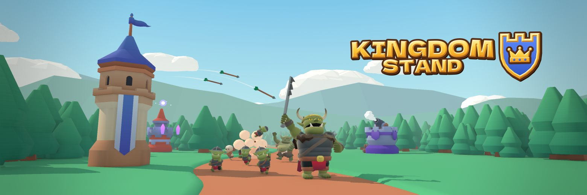
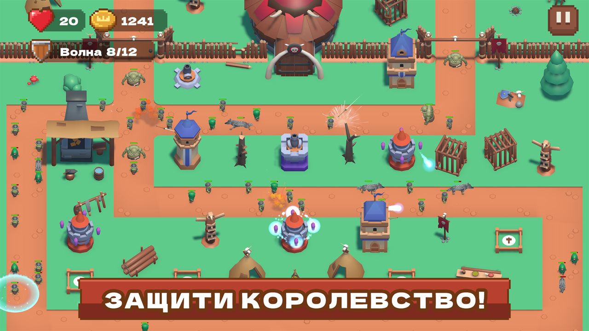
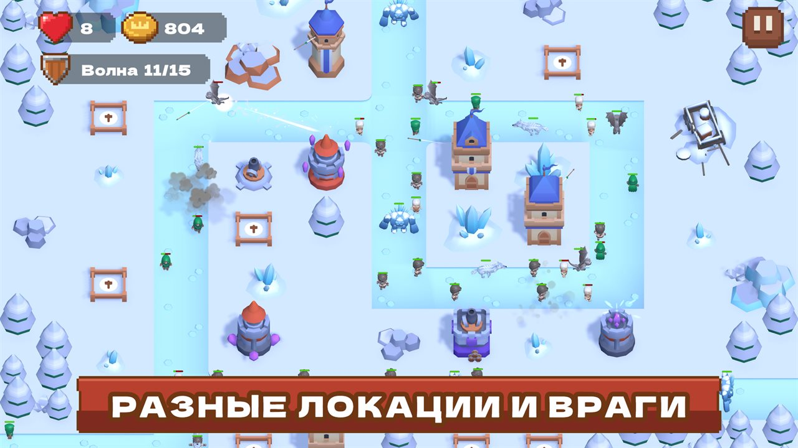
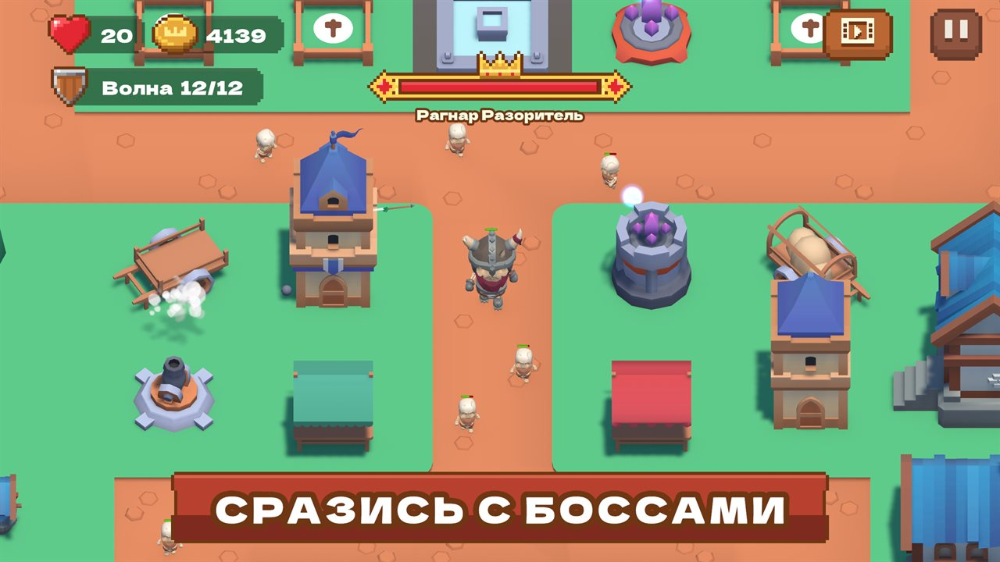
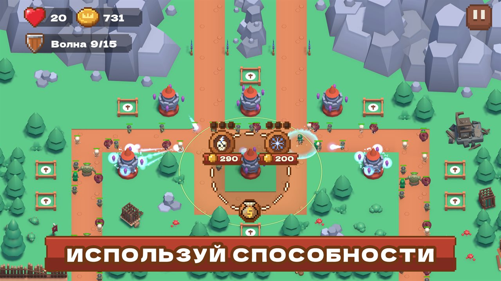
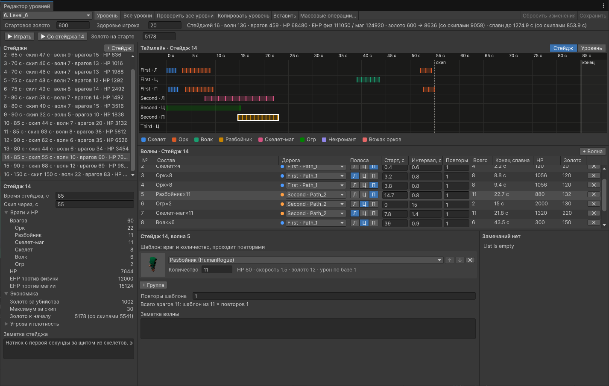

<p align="center">
  
</p>

# Kingdom Stand

3D tower defense в фэнтези-сеттинге для браузера. Башни со способностями, боссы, бесконечный режим.

**[▶ Играть в браузере](https://watchfire-keep.itch.io/kingdom-stand)** — itch.io, ПК и телефон

Unity 6.3 · C# · URP · WebGL · май — ноябрь 2026

<p align="center">
  
  
  
  
</p>

## О проекте

Игра выпущена на itch.io 17.11.2026. Веб-сборки — под itch.io и Яндекс Игры; управление — мышь и клавиатура на ПК,
касания на телефоне.

Содержание: 9 уровней кампании и бесконечный режим, 3 вида башен с улучшениями и способностями, 16 видов врагов,
включая боссов.

Объём кода — ≈53 тыс. строк C# в ≈720 файлах, без сгенерированного. Ядро написано вручную, доводка до релиза велась с использованием
ИИ-агента — см. [«Как я работаю с ИИ-агентом»](#как-я-работаю-с-ии-агентом).

## Стек

- **Движок:** Unity 6.3 (6000.3), C#, URP.
- **Ядро — собственное:** сущности из компонентов и систем, DI-контейнер, машина состояний, реактивные переменные
  и события. Сторонние фреймворки (Zenject, Entitas, DOTS) не используются.
- **Интерфейс:** uGUI, TextMesh Pro, анимации — DOTween. Окна редактора — UI Toolkit (UXML, USS).
- **Данные:** конфиги на ScriptableObject с загрузкой из `Resources`; сохранения и срезы баланса — JSON
  (Newtonsoft.Json).
- **Веб:** WebGL со сжатием Brotli, браузерные плагины `.jslib`, SDK Яндекс Игр (PluginYourGames) — облачные
  сохранения, язык, реклама.

## Что реализовано

### Ядро

Подробно — в разделе [«Архитектура»](#архитектура).

- **Сущности** — набор компонентов и собственный список систем: 168 компонентов, 52 системы. Типизированный доступ
  к компонентам (`entity.MoveSpeed`, `entity.AddMoveSpeed(...)`) генерируется редакторским скриптом.
- **DI** — собственный иерархический контейнер: проектный — на всю сессию, дочерний — на каждую сцену.
- **Жизненный цикл сцены** — бутстрап в три шага; на сцене один `Update`, контексты обновляются в фиксированном
  порядке.
- **ИИ** — иерархическая машина состояний с параллельными состояниями и переходами по условиям.
- **UI** — MVP: 29 презентеров, попапы через сервис окон.

### Игровые системы

- **Башни:** 3 вида (лучники, пушки, маги), 4 уровня улучшения, на IV уровне — 2 способности с прокачкой
  (оглушение, яд, осколки снарядов, дополнительные цели и др.).
- **Бой:** характеристики с модификаторами, статусы (заморозка, оглушение, урон со временем, ускорение), типы урона
  и сопротивления, баллистика снарядов, урон по площади.
- **Враги:** 16 видов, включая боссов; летающие враги; способности — призыв скелетов, боевой клич (ускоряет союзников
  в радиусе), бросок снежка (замораживает башню).
- **Уровни:** 9 уровней кампании, каждый уровень декорировался и настраивался индивидуально; стадии и волны из конфигов, досрочный вызов волны.
- **Бесконечный режим:** генератор волн по конфигу — состав, раскладка по дорогам, боссы, рост здоровья по циклам.
  Генерация детерминирована: из одного зерна создаются отдельные генераторы случайных чисел на забег, цикл и волну.
  Рекорды.
- **Обучение:** шаги на первых уровнях — указатели на постройку, улучшение и вызов волны, подсказка по камере;
  подсказки о новых врагах.
- **Мета:** главное меню, выбор уровней, энциклопедия, настройки.
- **Сохранения:** `SaveLoadService` с асинхронным репозиторием `IDataRepository`; реализация выбирается при сборке —
  облако Яндекс Игр, `localStorage` браузера, локальный файл.
- **Локализация:** русский и английский. Русский — исходный язык, перевод — по таблице; язык определяется через SDK
  площадки или по системе.
- **Звук:** музыка, звуки боя и интерфейса.
- **Ввод:** мышь и горячие клавиши на ПК, касания на телефоне.

### Производительность: веб и телефон

Целевое устройство — телефон минимальных требований (Redmi Note 8 Pro, мобильный браузер).

- **Пулы:** враги, снаряды и эффекты частиц переиспользуются; враги уровня создаются заранее по составу волн.
  Состояние объекта при возврате в пул сбрасывается в одном месте — `MonoEntity.ResetForReuse`.
- **Склейка мешей врагов:** при загрузке уровня части модели (кожа и детали на костях) сливаются в один
  `SkinnedMeshRenderer` — один вызов отрисовки на материал. Вызовов на врага — ≈8 → ≈1,7.
- **Итог:** цена живого врага в кадре на телефоне — ≈1 мс → ≈0,5 мс.
- **Два набора текстур в одной сборке:** DXT для ПК и ETC2 для телефонов; `index.html` выбирает файл данных по
  поддержке формата видеокартой.
- **Замер на устройстве:** встроенная панель замера под символом компиляции, в релиз не входит.

### Инструменты редактора

<p align="center">
  
</p>

- **Редактор уровней** (UI Toolkit): таблицы уровней и волн, таймлайн стадий, график сложности, расчёт статистики
  уровня, покрытие дорог зонами башен, проверки конфигов с ошибками и предупреждениями, массовая правка, копирование
  уровней, стадий и волн, разметка дорог в окне сцены.
- **Срезы баланса:** экспорт и импорт уровня в JSON, сравнение срезов — правки баланса делаются текстом, в том числе
  ИИ-агентом.
- **Плейтесты:** запуск уровня из редактора, логи прогонов со сводкой, бот, который проходит уровень по JSON-плану
  покупок с ускорением времени.
- **Сборка:** веб-сборка под площадку одной командой меню — переключение платформы плагина, сборка, возврат
  исходного состояния.
- **Генератор API сущностей** — пункт меню, перезаписывает один файл `Generated/EntityAPI.cs`.

## Архитектура

### Контейнеры и сцены

- Проектный контейнер создаётся в `GameEntryPoint` и живёт всю сессию. При смене сцены `SceneSwitcherService`
  освобождает контейнер прошлой сцены, загружает новую и создаёт для неё дочерний контейнер.
- Регистрация — фабрика-лямбда; объект — синглтон своего контейнера; `NonLazy()` — создать сразу, а не по первому
  запросу. `IInitializable` и `IDisposable` вызывает контейнер. Циклические зависимости обнаруживаются при разрешении.
- Зависимости объявляются явным списком в конструкторе. Контейнер передаётся только фабрикам с заранее неизвестным
  набором зависимостей; в остальном коде он виден только в `*ContextRegistrations`.
- Сцену поднимает наследник `SceneBootstrap` в три шага: регистрации → асинхронная подготовка → старт.
- `Update` на сцене один — у бутстрапа. В бою порядок такой: горячие клавиши → камера → цикл боя → погода → превью
  маршрутов → ввод → сущности → ИИ → пул эффектов → полоски здоровья. Отдельных `MonoBehaviour.Update` для логики нет.

### Сущность

- Сущность — набор компонентов и собственный список систем. Глобальных систем, обходящих все сущности, нет: фабрика
  создаёт инстансы систем для конкретной сущности, и система хранит её состояние.
- Компонент — только данные, одно поле `Value`. Тип поля задаёт роль: `ReactiveVariable<T>` — состояние,
  `ReactiveEvent` — сигнал, `ICompositeCondition` — вычисляемое условие. Имена: `…Request` — запрос, `…Event` — событие,
  `In…` — текущая фаза, `Can…` и `Must…` — условие.
- Система кеширует ссылки на компоненты в `OnInit` и дальше работает со своими полями. Системы не знают друг о друге:
  связь — только через компоненты.
- Unity-объекты попадают в сущность только через регистраторы на префабе. `EntityView` подписывается на компоненты
  и не меняет игровое состояние.
- Доступ к компонентам — через сгенерированный partial-класс `Entity`: генератор находит рефлексией все типы
  `IEntityComponent` и пишет для каждого свойство, `TryGet…` и `Add…`.
- Освобождение отложенное: `EntitiesLifeContext.Release` ставит сущность в очередь, удаление — после прохода
  обновления.

Пример системы — движение через `Rigidbody`:

```csharp
public class RigidbodyMovementSystem : IInitializableSystem, IUpdatableSystem
{
    private ReactiveVariable<Vector3> _moveDirection;
    private ReactiveVariable<float> _moveSpeed;
    private ReactiveVariable<bool> _isMoving;
    private Rigidbody _rigidbody;

    private ICompositeCondition _canMove;

    public void OnInit(Entity entity)
    {
        _moveDirection = entity.MoveDirection;
        _moveSpeed = entity.MoveSpeed;
        _isMoving = entity.IsMoving;
        _rigidbody = entity.Rigidbody;

        _canMove = entity.CanMove;
    }

    public void OnUpdate(float deltaTime)
    {
        if (_canMove.Evaluate() == false)
        {
            _rigidbody.linearVelocity = Vector3.zero;
            _isMoving.Value = false;
            return;
        }

        Vector3 velocity = _moveDirection.Value.normalized * _moveSpeed.Value;

        _isMoving.Value = velocity.magnitude > 0;

        _rigidbody.linearVelocity = velocity;
    }
}
```

### ИИ

- `StateMachine<TState>` наследует `State`, поэтому машины вкладываются друг в друга; `ParallelState` выполняет
  несколько состояний одновременно. Переходы — по `ICondition`; условия собираются из `FuncCondition`
  в `CompositeCondition`.
- Мозг сущности собирает `BrainsFactory`, обновляет `AIBrainsContext`. Пример — башня: «поиск цели» → «атака», если
  цель есть и башня не заморожена; обратно — когда атака закончилась.
- Состояния не вызывают системы: они выставляют запросы в компоненты, системы их исполняют.

### Интерфейс

- MVP. Презентер — обычный C#-класс: зависимости в конструкторе, подписки в `Initialize`, освобождение в `Dispose`.
  View — `MonoBehaviour`, знает только свои элементы и отдаёт события наружу.
- Презентеры создаёт фабрика презентеров своего контекста (проект, меню, бой); попапы открываются через сервис попапов
  контекста.

## Путеводитель по коду

Весь код — в `Assets/_Project/Develop`:

```text
Editor/             инструменты редактора: редактор уровней, плейтесты, сборка, генератор API
Runtime/
  Configs/          классы конфигов (ScriptableObject)
  Gameplay/         бой: ядро сущностей, фичи, режимы игры, бутстрап сцены
  Infrastructure/   точка входа, DI-контейнер
  Meta/             главное меню, прогресс уровней, настройки
  UI/               MVP-модули интерфейса
  Utilities/        код без знаний об игре: реактивные типы, условия, машина состояний, сохранения, сцены
```

| Что посмотреть | Файл |
|---|---|
| Сущность | [Entity.cs](Assets/_Project/Develop/Runtime/Gameplay/EntitiesCore/Entity.cs) |
| Сборка врага из компонентов и систем | [Melee.cs](Assets/_Project/Develop/Runtime/Gameplay/EntitiesCore/EntitiesFactory/Melee.cs) |
| Набор компонентов фичи | [MovementComponents.cs](Assets/_Project/Develop/Runtime/Gameplay/Features/MovementFeature/MovementComponents.cs) |
| Обновление и отложенное освобождение сущностей | [EntitiesLifeContext.cs](Assets/_Project/Develop/Runtime/Gameplay/EntitiesCore/EntitiesLifeContext.cs) |
| Генератор API сущностей | [EntityAPIGenerator.cs](Assets/_Project/Develop/Editor/EntityAPIGenerator.cs) |
| DI-контейнер | [DIContainer.cs](Assets/_Project/Develop/Runtime/Infrastructure/DI/DIContainer.cs) |
| Точка входа | [GameEntryPoint.cs](Assets/_Project/Develop/Runtime/Infrastructure/Boot/GameEntryPoint.cs) |
| Смена сцен и контейнеры сцен | [SceneSwitcherService.cs](Assets/_Project/Develop/Runtime/Utilities/SceneManagment/SceneSwitcherService.cs) |
| Бутстрап боя и порядок `Update` | [GameplayBootstrap.cs](Assets/_Project/Develop/Runtime/Gameplay/Infrastructure/GameplayBootstrap.cs) |
| Регистрации сцены боя | [GameplayContextRegistrations.cs](Assets/_Project/Develop/Runtime/Gameplay/Infrastructure/GameplayContextRegistrations.cs) |
| Машина состояний | [StateMachine.cs](Assets/_Project/Develop/Runtime/Utilities/StateMachineCore/StateMachine.cs) |
| Сборка мозгов ИИ | [BrainsFactory.cs](Assets/_Project/Develop/Runtime/Gameplay/Features/AI/Brains/BrainsFactory.cs) |
| Презентер попапа | [UpgradeTowerPopupPresenter.cs](Assets/_Project/Develop/Runtime/UI/Gameplay/UpgradeTowerPopup/UpgradeTowerPopupPresenter.cs) |
| Пулы и связь сущности с префабом | [MonoEntitiesFactory.cs](Assets/_Project/Develop/Runtime/Gameplay/EntitiesCore/Mono/MonoEntitiesFactory.cs) |
| Склейка мешей врага | [SkinnedMeshCombiner.cs](Assets/_Project/Develop/Runtime/Utilities/Rendering/SkinnedMeshCombiner.cs) |
| Сохранения и репозитории | [DataManagment/](Assets/_Project/Develop/Runtime/Utilities/DataManagment) |
| Генератор волн бесконечного режима | [EndlessWavesGenerator.cs](Assets/_Project/Develop/Runtime/Gameplay/Features/EndlessMode/EndlessWavesGenerator.cs) |
| Окно редактора уровней | [LevelEditorWindow.cs](Assets/_Project/Develop/Editor/LevelEditor/Window/LevelEditorWindow.cs) |
| Бот плейтестов | [PlaytestBot.cs](Assets/_Project/Develop/Editor/LevelEditor/Playtest/PlaytestBot.cs) |
| Сборка под площадку | [StoreBuild.cs](Assets/_Project/Develop/Editor/Build/StoreBuild.cs) |

## Как я работаю с ИИ-агентом

До 20.09.2026 код писался вручную: ядро (сущности, DI, машина состояний, MVP, конфиги, сохранения) и первая
играбельная версия игры. 20.09.2026 в репозитории появился первый `CLAUDE.md`; после этого код писал ИИ-агент
(Claude Code) под моим управлением: я ставил задачи, согласовывал решения, проверял результат в Play Mode и делал
ревью.

| | 17.09.2026 | Релиз, 17.11.2026 |
|---|---|---|
| Файлы C# | 364 | 719 |
| Строки C# | 17,3 тыс. | 53 тыс. |

По `git blame` в текущем коде ≈14,5 тыс. строк — из ручного периода, ≈38,5 тыс. — из периода с агентом. Крупное из
второго: редактор уровней ≈13,5 тыс. строк, интерфейс ≈8,4 тыс., геймплей ≈10,3 тыс., бесконечный режим ≈2 тыс.

Как устроена работа:

- **Правила проекта** — [`CLAUDE.md`](CLAUDE.md): стек, границы правок, архитектурные инварианты (сущности, граница
  с Unity, DI, жизненный цикл сцены, UI). Агент читает его в каждой сессии.
- **Стиль кода** — [`.claude/rules/code-style.md`](.claude/rules/code-style.md) и [`.editorconfig`](.editorconfig):
  структура файла, именование, форматирование.
- **Многосессионные планы** — крупная задача делится на этапы с проверкой после каждого. Для этапа заданы модель
  и уровень рассуждений агента; решения и итоги записываются в план, следующая сессия начинается с него.
- **Скиллы** — инструкции под повторяющиеся задачи: добавление врага, сборка уровня, баланс, перенос макетов
  интерфейса в uGUI, подбор звуков.
- **Память** — решения и выводы, которые переходят между сессиями: что проверено, что не сработало, чего не трогать.
- **Редактор Unity** — агент управляет запущенным редактором через Unity CLI: сцены и префабы правятся командами
  редактора, а не текстом YAML.
- **Проверка** — автотестов нет, каждое изменение проверяется в Play Mode. Коммиты разбиваются и подписываются
  по согласованию.
- **Баланс** — через ручные правки и прогоны, срезы уровней в JSON и бота плейтестов: агент предлагает правку текстом, бот прогоняет уровень,
  лог прогона разбирается.

Файлы скиллов, памяти и планов в репозиторий не входят.

## Почему проект не открывается в Unity

Репозиторий — витрина кода. В нём только код из `Assets/_Project/Develop`, правила для агента и этот README. История
коммитов перенесена из рабочего репозитория фильтром — с первого дня разработки; коммиты, где менялись только ассеты,
в неё не вошли.

Ассеты (модели, текстуры, звуки, шрифты, паки Asset Store), сцены, префабы, конфиги, настройки проекта и сторонние
плагины остались в приватном рабочем репозитории: лицензии сторонних ассетов не разрешают их публикацию. Поэтому проект
в Unity не откроется и не скомпилируется. Игра — [в браузере](https://watchfire-keep.itch.io/kingdom-stand).

## Авторские права и контакты

© 2026 Иван Смирнов. Все права защищены. Код открыт для просмотра и оценки; использование, копирование, изменение
и распространение — только с письменного разрешения автора. Подробно — в [LICENSE](LICENSE).

- GitHub: [TheImperialGuard](https://github.com/TheImperialGuard)
- Почта: ivan.smirnov.dm@gmail.com
- Telegram: [@Smirnov01](https://t.me/Smirnov01)
